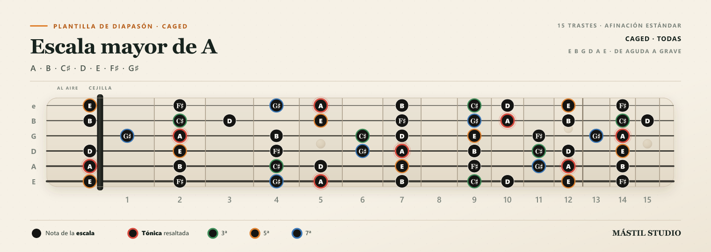
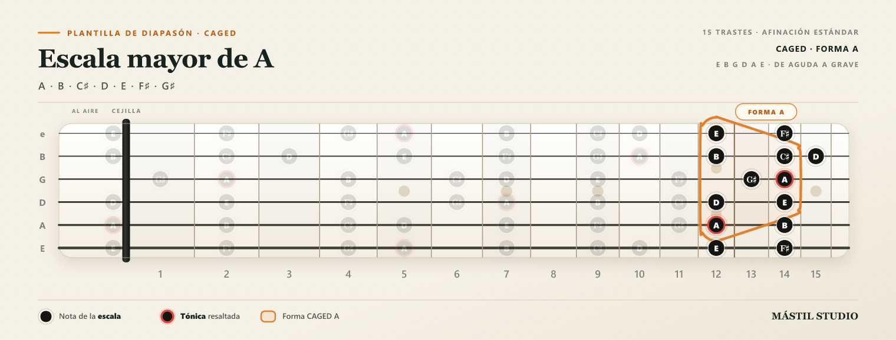
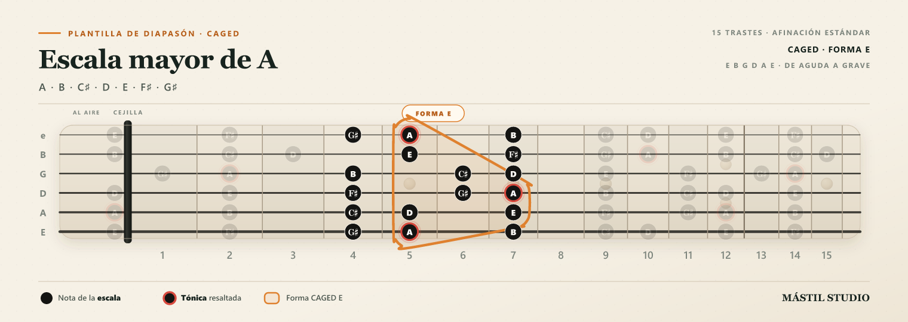
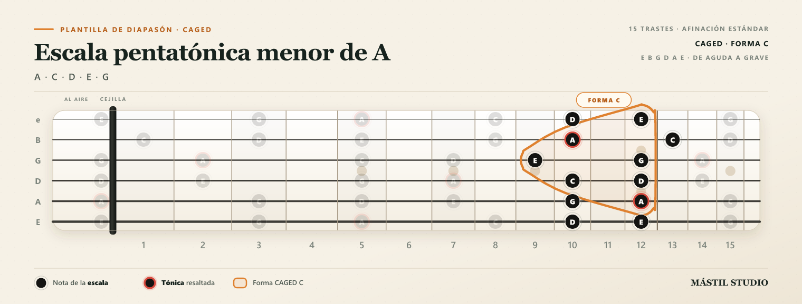
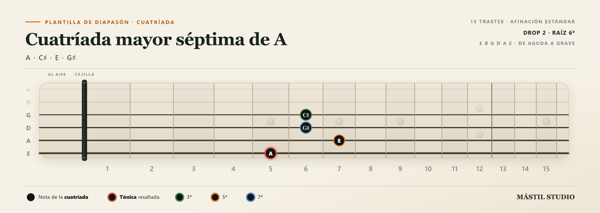

# Mástil Studio

Generador de plantillas SVG de diapasón para escalas, triadas, arpegios y cuatríadas, con posiciones CAGED, tónicas resaltadas y exportación vectorial.


## Estado

Prueba funcional `v0.1`. La aplicación web, el motor de teoría, el render SVG y las exportaciones ya funcionan. La siguiente etapa es refinar el modelo CAGED y agregar cejilla móvil, afinaciones alternativas y láminas con varias posiciones.

Lista viva de lo que queda: [PENDIENTES.md](PENDIENTES.md).

Análisis, arquitectura modular y estimación para la futura app de **páginas de entrenamiento** (escalas, arpegios, tríadas y acordes): [docs/APP-ENTRENAMIENTO.md](docs/APP-ENTRENAMIENTO.md).

Versiones guardadas:

- [v1.0](versions/v1.0): antes de compactar el mástil y agregar cuatríadas.
- [v1.1](versions/v1.1): antes de la nueva lógica de digitaciones.
- [v1.2](versions/v1.2): digitaciones de 2–3 notas por cuerda.
- [v1.3](versions/v1.3): ventanas CAGED A/G/D corregidas y ajustes visuales.
- [v1.4](versions/v1.4): forma A trasladada a 12–15 para no superponerse con G.
- [v1.5](versions/v1.5): forma A ajustada a **11–15**.

ZIPs: [v1.0](versions/mastil-studio-v1.0.zip) · [v1.1](versions/mastil-studio-v1.1.zip) · [v1.2](versions/mastil-studio-v1.2.zip) · [v1.3](versions/mastil-studio-v1.3.zip) · [v1.4](versions/mastil-studio-v1.4.zip) · [v1.5](versions/mastil-studio-v1.5.zip).

## Mástil Lab (nuevo)

Además del generador de plantillas, el repo incluye **Mástil Lab**, un estudio de guitarra interactivo en `http://127.0.0.1:4173/lab/`: 27 herramientas que suenan, preguntan y recuerdan lo que practicas. Todo funciona en el navegador, sin cuentas ni dependencias; el progreso se guarda en `localStorage` y, tras la primera visita, **funciona sin conexión** (instalable como app).

| Grupo | Herramienta | Qué hace |
|---|---|---|
| Aprender el mástil | **Fretboard Navigator** | Mástil de hasta 24 trastes con audio al pulsar, entrada MIDI (lo que tocas se ilumina), 14 afinaciones (incluye bajo y 7 cuerdas), modo zurdo, posiciones «N por cuerda», cajas, CAGED, voicings e inversiones, etiquetas (nombre, Do-Re-Mi, grado), exportar PNG/SVG y enlace compartible |
| | **Triad Lab** | Tríadas y cuatríadas por juegos de cuerdas e inversiones, acorde sobre su escala, arpegios por posición con dedos, conducción de voces (camino de mínimo movimiento entre acordes), superposición de dos acordes y lámina CAGED de 5 mástiles imprimible |
| | **Mástil a ciegas** | La app pide una nota en una cuerda y tú la encuentras sin ver el mástil; respuesta por micrófono, guitarra MIDI o manual, rondas de 10 con tiempo medio |
| | **Theory Trainer** | Quizzes de notas del mástil, encontrar la nota, intervalos, acordes de la tonalidad, números romanos, modos y armaduras; 3 niveles, modo 2 minutos, puntos débiles y **repaso espaciado** (cajas de 1–32 días) |
| | **Chord & Key Finder** | Nombra un acorde a partir de sus notas, muestra sus formas, lista los acordes de cualquier tonalidad/modo y deduce la tonalidad de una canción |
| Practicar | **Rutina guiada** | Sesión a medida (15–90 min) con bloques cronometrados; da más peso a tus puntos débiles, a las tarjetas vencidas y a lo que menos practicas |
| | **Timing Lab** | Mide tu pulso con el micrófono: desviación de cada nota en ms, histograma, tendencia a adelantarte o arrastrar, modo «sólo la cuenta» (pulso interno), calibración de latencia e historial |
| | **Drills técnicos** | 11 ejercicios (púa alterna, cruce de cuerdas, economy, sweep, legato, trino, saltos de cuerda, independencia con las 24 permutaciones, hybrid, tapping, palm muting) con **escalera de velocidad** (sube el tempo sólo con N repeticiones limpias), práctica en ráfagas, detección de estancamiento y récords por ejercicio |
| | **Autograbación** | Grábate (audio o vídeo) y revisa la toma a 50/75 % con forma de onda; no sale de tu navegador |
| | **Audio Lab** | Tus propias canciones: velocidad 25–150 % sin cambiar el tono, bucle A-B con forma de onda, subida de velocidad por vuelta, cuenta previa, marcadores y **transcripción asistida** (acorde probable del tramo y progresión aproximada) |
| | **Biblioteca de ejercicios** | 45 ejercicios de digitación que se generan en cualquier tonalidad, posición y afinación: **permutaciones de dedos** (las 24 de 1-2-3-4 sobre la escala y cromáticas, y de 3 notas), **secuencias de escala** (18 patrones: terceras, grupos, tríadas y séptimas diatónicas…), **pentatónica y blues** (cajas, patrones y las cinco cajas encadenadas), **intervalos melódicos** (3.ª a 8.ª), **dobles cuerdas** (terceras, sextas, octavas… a la vez o arpegiadas), arpegios por posiciones y **legato**. Con dedos sugeridos (1-4), partitura + tab de alphaTab que suenan con cursor |
| | **Exercise Generator** | Secuencias (terceras, grupos, zigzag, sweep…) sobre escalas/arpegios con tab, bucle, cuenta previa y metrónomo |
| | **Metrónomo y caja de ritmos** | Acentos por pulso, subdivisiones, swing, entrenador de velocidad, compases en silencio, temporizador, tap tempo y caja de ritmos de 16 pasos |
| | **Strum Trainer** | Patrones de rasgueo con acentos, apagados y silencios sobre tus acordes |
| | **Rhythm Trainer** | Ritmos aleatorios, modo «de memoria» y medición de tus toques con la barra espaciadora |
| | **Vibrato Trainer** | Nota sostenida que sube y baja al compás, con entrenador de velocidad |
| | **Practice Log** | Minutos por día (automático + manual), racha, meta diaria y semanal, 16 semanas, 16 logros, notas y copia de seguridad completa (JSON) |
| Tocar y escribir | **Jam Studio** | La base suena y el mástil sigue los acordes: escala sugerida por acorde (dórica sobre ii, mixolidia sobre V, blues…), notas 1-3-5-7 en color, aviso del siguiente cambio, enfoque escala/pentatónica/acorde/tríada/arpegio, retos de aterrizaje puntuados con micrófono o MIDI, tempo progresivo, compases en silencio y bucle de sección; 14 progresiones |
| | **Licks y respuesta** | Frases (7 de ejemplo + los tuyos) transpuestas a las 12 tonalidades por el círculo de quintas, en llamada y respuesta con evaluación opcional por micrófono |
| | **Backing Track Creator** | Batería, bajo, guitarra y sinte sobre una progresión editable; 11 grooves (rock, pop, funk, shuffle, jazz, bossa, country, reggae, balada, 3/4, 6/8, 12/8); guarda tus bases y expórtalas a MIDI |
| | **Tab Creator** | Rejilla con ligados, slides, bends, vibrato, armónicos; reproducción, importar/exportar texto, PDF, **MIDI y MusicXML**; vista **Partitura** con alphaTab (la tab se pinta como pentagrama + tablatura y se toca con cursor) |
| | **Partitura (alphaTab)** | Editor de **alphaTex** con render en vivo, **abre Guitar Pro (.gp/.gp5/.gpx) y MusicXML**, reproducción con cursor, bucle, metrónomo, cuenta previa y velocidad, exporta MIDI; convierte a/desde la rejilla del Tab Creator |
| | **Randomiser** | Notas, ritmos, progresiones por complejidad, riffs con tab, ideas de jam y retos |
| | **Capo & Transpose** | Transposición y la cejilla con las formas abiertas más fáciles |
| Oído y afinación | **Ear Trainer** | Intervalos y calidades de acorde con guitarra o piano; repite lo que fallas |
| | **EQ Trainer** | Identifica qué banda de frecuencias se ha realzado o recortado en una base |
| | **Guitar Tuner** | Afinador por micrófono (autocorrelación) con detección de cuerda |
| Referencia | **Referencias rápidas** | Escalas en las 12 tonalidades, acordes por tonalidad, afinaciones y círculo de quintas |

**Todas las tablaturas se pintan con alphaTab** (Drills, Exercise Generator, Biblioteca de ejercicios, Licks, Randomiser, Tab Creator y Partitura): flechas de púa, dedos, ligados, tap, palm mute y un cursor que sigue el ejercicio mientras suena. El modo «Texto» del Tab Creator se conserva sólo para copiar/exportar.

Las herramientas están conectadas: «Practica esto» en el Navigator abre los ejercicios, el backing o el quiz con la misma tonalidad, y el Randomiser envía progresiones y riffs al Backing y al Tab Creator. El audio es síntesis pura (Karplus-Strong para la guitarra, osciladores y ruido para batería, bajo y pad), sin muestras.

```text
lab/index.html, lab/lab.css   Shell, rutas por hash (#/herramienta?param=valor)
lab/js/core/                  Lógica pura y testeable: música, acordes, ritmo, ejercicios, quiz, oído,
                              práctica, tab, riffs, pitch, estado en URL
lab/js/audio/                 Motor WebAudio, transporte con anticipación, reproductores de backing y tab
lab/js/ui/                    Mástil SVG interactivo, diagramas de acorde, exportación, helpers DOM
lab/js/tools/                 Una pantalla por herramienta
lab/vendor/alphatab/          alphaTab 1.9.0 (MPL-2.0) en copia local: render, fuente Bravura y soundfont, para usarlo sin conexión
```

## Probar

Requiere Node.js 20 o superior.

```bash
npm start
```

Abrir `http://127.0.0.1:4173`.

No hay dependencias de runtime ni proceso de build: el servidor sólo sirve archivos estáticos y el navegador ejecuta módulos ES.

```bash
npm test       # 146 pruebas: teoría, parser, CAGED, voicings, digitaciones, SVG y el núcleo del Lab (jam, tríadas, MIDI, repaso espaciado, rutinas, biblioteca de ejercicios y alphaTex)
npm run precache  # regenera lab/precache.json (lista del modo sin conexión) tras añadir archivos al Lab
npm run export # regenera los SVG de ejemplo en output/
```

## Qué incluye esta versión

- Diapasón de **15 trastes**, más una columna de cuerdas al aire y una cejilla/ceja en el extremo izquierdo.
- **Mástil compacto en altura, ahora un 20 % más alto**: el área del diapasón pasó de 190 a **228 px** (60 % de la altura original) y el SVG base mide **1520 × 578 px**.
- **Diapasón claro**: el mástil usa un blanco marfil (`#faf7f0`) con degradado vertical suave (`#ffffff` → `#faf7f0` → `#f4eee2`) y borde `#d9cfbc`, para que las notas y los marcadores se lean sobre un fondo limpio. El color se define en `COLORS.board` / `COLORS.boardEdge` y en el gradiente `#board` de `src/svg.js`.
- **Distancias de traste reales** (temperamento igual): el primer traste es notablemente más ancho que el 15.º.
- Afinación estándar **E B G D A E**, con la primera cuerda arriba y la sexta abajo. El grosor de línea crece de la aguda a la grave.
- Notas negras, nombre en blanco y **doble borde en todas las notas**: rojo y marcado en las tónicas, fino y discreto en el resto. Todos los nombres usan el mismo tamaño, tengan o no sostenidos/bemoles.
- Las cuerdas al aire quedan **casi tangentes a la cejilla**.
- Marcadores de posición **estilo Stratocaster**, grandes, lisos y muy tenues para no competir con las notas, ligeramente desplazados hacia el lado grave y con doble punto ancho en el traste 12. También aparecen en 5, 7, 9 y 15.
- **Cuerdas activas:** cada cuerda se puede apagar; su línea queda atenuada y no se dibujan notas sobre ella.
- **Etiquetas Nombre / Grado**: las notas pueden mostrar `A`, `C♯`… o grados como `1`, `♭3`, `3M`, `5`, `7m`.
- **Colores por función**: borde rojo para la tónica, verde para la 3ª, naranja para la 5ª y azul para la 7ª. Se puede activar o desactivar.
- Entrada en lenguaje natural:
  - `Escala A`
  - `Escala A menor`
  - `Triada C#m`
  - `Arpegio G7`
  - `Escala La bemol mayor`
  - `Triada Fa sostenido menor`
- Escalas: mayor, menor natural, menor armónica, menor melódica, aumentada, disminuida, pentatónica mayor, pentatónica menor, blues, dórica, frigia, lidia, mixolidia y locria.
- Triadas: mayor, menor, aumentada y disminuida.
- Arpegios: mayor 7, menor 7, dominante 7, aumentado 7 y disminuido 7.
- **Cuatríadas en fundamental**, con la raíz en 5ª o 6ª cuerda:
  - calidades mayor 7, menor 7, dominante 7, semidisminuida 7, disminuida 7 y menor con séptima mayor;
  - **Drop 2** y **Drop 3**;
  - cuatro notas sobre cuatro cuerdas, sin CAGED;
  - selección de drop y cuerda de la fundamental desde la interfaz.
- Selector de posición CAGED **C A G E D**:
  - al elegir una forma en escalas se dibuja una **digitación ergonómica**: grupos de 2–3 notas por cuerda, máximo 4 trastes, con preferencia por Tono+Semitono o Semitono+Tono y Tono+Tono como excepción;
  - `Todas` sigue mostrando el mapa completo de la escala;
  - el resaltado naranja es **opcional y está apagado por defecto**;
  - con el resaltado activo, `Todas` muestra la guía de ventanas y una forma concreta dibuja el contorno y la etiqueta;
  - sin el resaltado, la forma elegida sigue atenuando el contexto, pero no dibuja naranja.
- **Zoom independiente desde la web**, todo de 50 % a 200 %:
  - **Círculos**;
  - **nombres de notas**;
  - **textos y etiquetas**.
  - Los cambios se aplican a la vista previa, al SVG y al PNG.
- Exportación **SVG autónomo** y **PNG 2×** (3040 × 1080 px en la plantilla compacta).
- En Chrome/Edge, **Guardar SVG/PNG** abre el diálogo nativo de Windows para elegir carpeta y nombre. Si el navegador no soporta el selector, se descarga en la carpeta de descargas habitual.
- Interfaz adaptable a escritorio, tablet y móvil.

## Ejemplos generados

- [Escala mayor de A](output/escala-a-mayor.svg)
- [Escala mayor de A · forma A](output/escala-a-mayor-forma-a.svg)
- [Escala mayor de A · forma E](output/escala-a-mayor-forma-e.svg)
- [Escala pentatónica menor de A · forma C](output/pentatonica-a-menor-forma-c.svg)
- [Cuatríada Amaj7 Drop 2](output/cuatriada-a-mayor7-drop2.svg)
- [Triada menor de C♯](output/triada-c-sostenido-menor.svg)
- [Arpegio dominante 7 de G](output/arpegio-g-dominante-7.svg)

Vista rápida de la plantilla completa:



En La mayor, la forma A va de **11–15**: empieza un traste antes de la tónica de 5ª (A/12) y termina en el límite del mástil. Queda **parcial**, porque la tónica de la 1ª cuerda estaría en el traste 17. La escala empieza con la posición **G** y la forma A aparece al final del mástil.



Forma E corregida, con 2–3 notas por cuerda (la fila del traste 4 completa el patrón):



Regresión de la forma C en La pentatónica menor: el C del traste 13 de la 2ª cuerda ya forma parte de la posición.



Cuatríada de La mayor 7 en Drop 2, fundamental en 6ª cuerda:



## Cómo está organizado

```text
index.html                 Interfaz
styles.css                 Sistema visual
server.mjs                 Servidor estático sin dependencias
src/theory.js              Notas, intervalos, enarmonía y colecciones
src/parser.js              Consultas en español/inglés
src/caged.js               Plantillas CAGED, afinación y geometría del mástil
src/fingering.js           Digitaciones de escala por grupos de 2–3 notas por cuerda
src/voicings.js            Cuatríadas Drop 2 / Drop 3 en posición fundamental
src/svg.js                 Render SVG autocontenido
src/diagram.js             Composición entre teoría, CAGED, voicings y SVG
src/app.js                 Estado de la interfaz, eventos y exportaciones
scripts/export-samples.mjs Generador de los SVG de ejemplo
tests/                     Pruebas con node:test
```

La función central para generar una plantilla desde código es `buildDiagram`:

```js
import { buildDiagram } from './src/diagram.js';

const { svg } = buildDiagram({
  root: 'A',
  family: 'scale',
  quality: 'major',
  shapeId: 'E', // 'all' | 'C' | 'A' | 'G' | 'E' | 'D'
  includeOpen: true,
  showCagedOverlay: false, // el naranja es opcional
  labelMode: 'name',       // 'name' | 'degree'
  colorRoles: true,        // 3ª verde, 5ª naranja, 7ª azul
  voicing: { drop: 'drop2', rootString: 6 }, // para family: 'cuatriad'
  activeStrings: [true, true, true, true, true, true],
  visual: {
    circleScale: 1,    // 0.5 a 2
    noteTextScale: 1,  // 0.5 a 2
    typeScale: 1.1,    // 0.5 a 2
  },
});
```

## Decisiones de esta prueba

- **Cuerda aguda arriba.** Se sigue la referencia: la primera cuerda (E aguda) queda arriba y la sexta (E grave) abajo. El grosor aumenta hacia la sexta.
- **Trastes 1–15.** La columna al aire es adicional y se puede ocultar con el interruptor «Mostrar cuerdas al aire».
- **Geometría de escala real.** La posición de cada traste se calcula con `1 - 2^(-n/12)` normalizado al traste 15. La separación se reduce hacia el cuerpo, como en un mástil real.
- **Cejilla en traste 0.** En esta versión la cejilla es fija en el extremo izquierdo. No transporta las notas; es una guía visual. La cejilla móvil queda para la siguiente iteración. Los puntos de cuerdas al aire se apoyan prácticamente contra la cejilla.
- **Marcadores tipo Stratocaster.** Los puntos simples están levemente desplazados hacia el lado grave (como en muchos mástiles Fender), y el doble punto del traste 12 mantiene una separación ancha. Son lisos: un relleno plano de arcilla con una opacidad del 38 %, sin degradado ni relieve, para quedar apenas perceptibles.
- **Doble borde en las notas.** Cada nota lleva el borde del disco y un aro exterior separado. La tónica mantiene el rojo fuerte (borde de 3,2 px y aro de 2 px al 20 %); el resto de las notas usa un aro de 1,2 px al 32 %, con el color de su función (3ª, 5ª o 7ª) o un gris neutro si no tiene función. El aro escala junto con `circleScale` y la leyenda del pie repite el mismo recurso.
- **Escalas visuales independientes.** `circleScale` controla el radio del círculo; `noteTextScale` controla el tamaño del nombre dentro de la nota; `typeScale` controla títulos, subtítulos, números de traste, etiquetas y leyendas. Las tres van de 50 % a 200 %. La posición de las cuerdas al aire se recalcula para seguir casi tangente a la cejilla en cualquier tamaño de círculo.
- **CAGED opcional.** El contorno, las etiquetas de forma y la leyenda naranja sólo se dibujan con `showCagedOverlay: true`. La selección de posición sigue existiendo para atenuar el contexto, pero el naranja queda pospuesto.
- **Cuerdas activas.** `activeStrings` es un array de seis booleanos; una cuerda apagada no genera notas y su línea/label se atenúan.
- **Cuatríadas root-position.** Para esta primera versión se generan voicings con la fundamental en el bajo:
  - Drop 2 en cuerdas 6-5-4-3 con raíz en 6ª, o 5-4-3-2 con raíz en 5ª.
  - Drop 3 en cuerdas 6-4-3-2 con raíz en 6ª, o 5-3-2-1 con raíz en 5ª.
  - El motor elige la colocación más compacta con extensión máxima de 5 trastes.
- **Formato compacto.** El tablero mide 228 px de alto (60 % del original, un 20 % más que la versión compacta anterior) y el lienzo **1520 × 578 px**. La barra lateral se ensanchó a 420 px en escritorio.
- **Grados contextuales.** En escalas se usan grados como `1, 2, ♭3, 4, 5, ♭6, ♭7`; en triadas, arpegios y cuatríadas se usa la notación de acorde `1, 3m, 3M, 5, 7m`.
- **Colores de función.** La tónica conserva el rojo; la 3ª, la 5ª y la 7ª se colorean con verde, naranja y azul. En escalas se colorean las funciones diatónicas (3ª, 5ª y 7ª) sin marcar alteraciones como funciones del acorde.
- **Enarmonía por grado.** La escala se escribe con letras consecutivas: A mayor es `A B C♯ D E F♯ G♯`; F mayor es `F G A B♭ C D E`. Fa natural usa bemoles como preferencia en escalas simétricas; por ejemplo, la disminuida de Fa es `F G A♭ B♭ B D♭ D E`.
- **Cuerdas al aire en voicings.** No cuentan para la extensión de la mano: un voicing como `0-0-0-11` es válido aunque su extensión total supere 5 trastes.
- **Tipografía de cabecera.** Título y subtítulo se separan dinámicamente cuando `typeScale` crece; el crecimiento del encabezado se limita a 1,4× para no invadir el mástil.
- **CAGED por ventanas.** Cada forma tiene una ventana de 3–6 trastes y una tónica de referencia. Al elegir una forma se atenúan las notas fuera de la ventana y se resalta la tríada que define esa forma. Las definiciones usadas son:
  - **A:** un traste antes de la tónica de 5ª hasta el traste de la tónica de 3ª. En La mayor se usa la octava alta **11–15**; queda parcial por el límite de 15 trastes.
  - **G:** de un traste antes de la tónica de 3ª a las tónicas de 1ª/6ª.
  - **D:** de un traste antes de la tónica de 4ª a la tónica de 2ª.
  - **C y E:** se mantienen como estaban.
  Las ventanas se completan además para que ninguna cuerda quede con una sola nota de la escala y para que la unión de notas, ordenada por altura, sea una secuencia continua de grados: si falta una nota entre dos cuerdas, la ventana se extiende hasta incluirla.
- **Digitación por cuerdas.** Con una forma seleccionada, las escalas se dibujan como un recorrido continuo de grupos de 2–3 notas por cuerda. Cada grupo abarca como máximo 4 trastes. La digitación se ancla a la ventana CAGED; por eso una posición abierta puede conservar Tono+Tono aunque el algoritmo lo penalice. `Todas` conserva el mapa completo.
- **Formas aumentadas y disminuidas.** Como no son formas CAGED tradicionales, se parte de la forma mayor/menor y se ajusta cada nota a la nota de acorde más cercana. Si una cuerda no puede alcanzar una nota del acorde sin un estiramiento excesivo, se omite.

## Próximos pasos sugeridos

1. **Auditar todas las digitaciones** de escalas, triadas, arpegios y cuatríadas: anclaje CAGED, span mínimo y familias horizontal/diagonal. La forma A de La mayor se movió a 11–15 para no superponerse con G; queda parcial por el límite de 15 trastes.
2. Cejilla móvil real: transportar el diagrama según el traste de cejilla.
3. Traste máximo ajustable con lienzo dinámico (base ya preparada).
4. Inversiones 1ª, 2ª y 3ª de cuatríadas, más otras octavas y juegos de cuerdas.
5. Voicings compactos de tríadas por grupos de cuerdas, con overrides manuales.
6. Lámina con las cinco posiciones CAGED en paneles separados.
7. Tríada sobre la escala, con la escala como contexto atenuado.
8. Afinaciones alternativas y modo zurdo.
9. Exportación PDF y presets de estilo (claro, oscuro, impresión).
10. Guardar/cargar plantillas por URL o archivo JSON.
