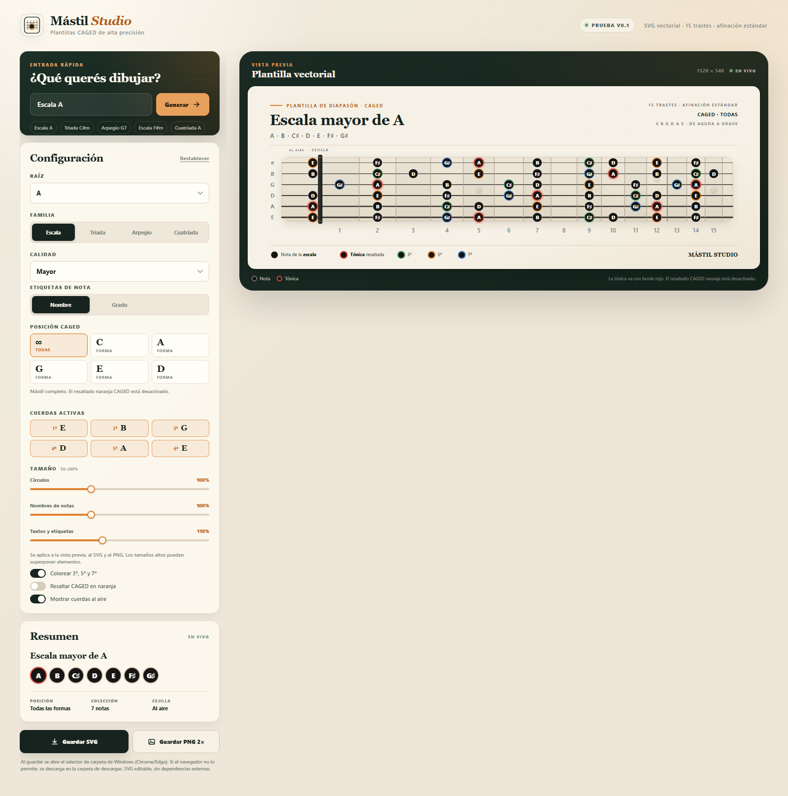

# Mástil Studio

Generador de plantillas SVG de diapasón para escalas, triadas, arpegios y cuatríadas, con posiciones CAGED, tónicas resaltadas y exportación vectorial.



## Estado

Prueba funcional `v0.1`. La aplicación web, el motor de teoría, el render SVG y las exportaciones ya funcionan. La siguiente etapa es refinar el modelo CAGED y agregar cejilla móvil, afinaciones alternativas y láminas con varias posiciones.

Lista viva de lo que queda: [PENDIENTES.md](PENDIENTES.md).

Versiones guardadas:

- [v1.0](versions/v1.0): antes de compactar el mástil y agregar cuatríadas.
- [v1.1](versions/v1.1): antes de la nueva lógica de digitaciones.
- [v1.2](versions/v1.2): digitaciones de 2–3 notas por cuerda.

ZIPs: [v1.0](versions/mastil-studio-v1.0.zip) · [v1.1](versions/mastil-studio-v1.1.zip) · [v1.2](versions/mastil-studio-v1.2.zip).

## Probar

Requiere Node.js 20 o superior.

```bash
npm start
```

Abrir `http://127.0.0.1:4173`.

No hay dependencias de runtime ni proceso de build: el servidor sólo sirve archivos estáticos y el navegador ejecuta módulos ES.

```bash
npm test       # 60 pruebas de teoría, parser, CAGED, voicings, digitaciones y SVG
npm run export # regenera los SVG de ejemplo en output/
```

## Qué incluye esta versión

- Diapasón de **15 trastes**, más una columna de cuerdas al aire y una cejilla/ceja en el extremo izquierdo.
- **Mástil compacto en altura**: el área del diapasón quedó al **50 %** de la altura original. El SVG base pasa a **1520 × 540 px**.
- **Distancias de traste reales** (temperamento igual): el primer traste es notablemente más ancho que el 15.º.
- Afinación estándar **E B G D A E**, con la primera cuerda arriba y la sexta abajo. El grosor de línea crece de la aguda a la grave.
- Notas negras, nombre en blanco y **borde rojo en todas las tónicas**. Todos los nombres usan el mismo tamaño, tengan o no sostenidos/bemoles.
- Las cuerdas al aire quedan **casi tangentes a la cejilla**.
- Marcadores de posición **estilo Stratocaster**, grandes y muy tenues para no competir con las notas, ligeramente desplazados hacia el lado grave y con doble punto ancho en el traste 12. También aparecen en 5, 7, 9 y 15.
- **Cuerdas activas:** cada cuerda se puede apagar; su línea queda atenuada y no se dibujan notas sobre ella.
- **Etiquetas Nombre / Grado**: las notas pueden mostrar `A`, `C♯`… o grados como `1`, `♭3`, `3M`, `5`, `7m`.
- **Colores por función**: borde rojo para la tónica, verde para la 3ª, naranja para la 5ª y azul para la 7ª. Se puede activar o desactivar.
- Entrada en lenguaje natural:
  - `Escala A`
  - `Escala A menor`
  - `Triada C#m`
  - `Arpegio G7`
  - `Escala La bemol mayor`
  - `Triada Fa sostenido menor`
- Escalas: mayor, menor natural, menor armónica, menor melódica, aumentada, disminuida, pentatónica mayor, pentatónica menor, blues, dórica, frigia, lidia, mixolidia y locria.
- Triadas: mayor, menor, aumentada y disminuida.
- Arpegios: mayor 7, menor 7, dominante 7, aumentado 7 y disminuido 7.
- **Cuatríadas en fundamental**, con la raíz en 5ª o 6ª cuerda:
  - calidades mayor 7, menor 7, dominante 7, semidisminuida 7, disminuida 7 y menor con séptima mayor;
  - **Drop 2** y **Drop 3**;
  - cuatro notas sobre cuatro cuerdas, sin CAGED;
  - selección de drop y cuerda de la fundamental desde la interfaz.
- Selector de posición CAGED **C A G E D**:
  - al elegir una forma en escalas se dibuja una **digitación ergonómica**: grupos de 2–3 notas por cuerda, máximo 4 trastes, con preferencia por Tono+Semitono o Semitono+Tono y Tono+Tono como excepción;
  - `Todas` sigue mostrando el mapa completo de la escala;
  - el resaltado naranja es **opcional y está apagado por defecto**;
  - con el resaltado activo, `Todas` muestra la guía de ventanas y una forma concreta dibuja el contorno y la etiqueta;
  - sin el resaltado, la forma elegida sigue atenuando el contexto, pero no dibuja naranja.
- **Zoom independiente desde la web**, todo de 50 % a 200 %:
  - **Círculos**;
  - **nombres de notas**;
  - **textos y etiquetas**.
  - Los cambios se aplican a la vista previa, al SVG y al PNG.
- Exportación **SVG autónomo** y **PNG 2×** (3040 × 1080 px en la plantilla compacta).
- En Chrome/Edge, **Guardar SVG/PNG** abre el diálogo nativo de Windows para elegir carpeta y nombre. Si el navegador no soporta el selector, se descarga en la carpeta de descargas habitual.
- Interfaz adaptable a escritorio, tablet y móvil.

## Ejemplos generados

- [Escala mayor de A](output/escala-a-mayor.svg)
- [Escala mayor de A · forma A](output/escala-a-mayor-forma-a.svg)
- [Escala mayor de A · forma E](output/escala-a-mayor-forma-e.svg)
- [Escala pentatónica menor de A · forma C](output/pentatonica-a-menor-forma-c.svg)
- [Cuatríada Amaj7 Drop 2](output/cuatriada-a-mayor7-drop2.svg)
- [Triada menor de C♯](output/triada-c-sostenido-menor.svg)
- [Arpegio dominante 7 de G](output/arpegio-g-dominante-7.svg)

Vista rápida de la plantilla completa:


Forma A anclada a **0–4**: A y D quedan al aire, A aparece en G/2 y se agrega **G♯ en la 1ª cuerda, traste 4**. La digitación usa 2–3 notas por cuerda y no contiene C ni F naturales.


Forma E corregida, con 2–3 notas por cuerda (la fila del traste 4 completa el patrón):


Regresión de la forma C en La pentatónica menor: el C del traste 13 de la 2ª cuerda ya forma parte de la posición.


Cuatríada de La mayor 7 en Drop 2, fundamental en 6ª cuerda:


## Cómo está organizado

```text
index.html                 Interfaz
styles.css                 Sistema visual
server.mjs                 Servidor estático sin dependencias
src/theory.js              Notas, intervalos, enarmonía y colecciones
src/parser.js              Consultas en español/inglés
src/caged.js               Plantillas CAGED, afinación y geometría del mástil
src/fingering.js           Digitaciones de escala por grupos de 2–3 notas por cuerda
src/voicings.js            Cuatríadas Drop 2 / Drop 3 en posición fundamental
src/svg.js                 Render SVG autocontenido
src/diagram.js             Composición entre teoría, CAGED, voicings y SVG
src/app.js                 Estado de la interfaz, eventos y exportaciones
scripts/export-samples.mjs Generador de los SVG de ejemplo
tests/                     Pruebas con node:test
```

La función central para generar una plantilla desde código es `buildDiagram`:

```js
import { buildDiagram } from './src/diagram.js';

const { svg } = buildDiagram({
  root: 'A',
  family: 'scale',
  quality: 'major',
  shapeId: 'E', // 'all' | 'C' | 'A' | 'G' | 'E' | 'D'
  includeOpen: true,
  showCagedOverlay: false, // el naranja es opcional
  labelMode: 'name',       // 'name' | 'degree'
  colorRoles: true,        // 3ª verde, 5ª naranja, 7ª azul
  voicing: { drop: 'drop2', rootString: 6 }, // para family: 'cuatriad'
  activeStrings: [true, true, true, true, true, true],
  visual: {
    circleScale: 1,    // 0.5 a 2
    noteTextScale: 1,  // 0.5 a 2
    typeScale: 1.1,    // 0.5 a 2
  },
});
```

## Decisiones de esta prueba

- **Cuerda aguda arriba.** Se sigue la referencia: la primera cuerda (E aguda) queda arriba y la sexta (E grave) abajo. El grosor aumenta hacia la sexta.
- **Trastes 1–15.** La columna al aire es adicional y se puede ocultar con el interruptor «Mostrar cuerdas al aire».
- **Geometría de escala real.** La posición de cada traste se calcula con `1 - 2^(-n/12)` normalizado al traste 15. La separación se reduce hacia el cuerpo, como en un mástil real.
- **Cejilla en traste 0.** En esta versión la cejilla es fija en el extremo izquierdo. No transporta las notas; es una guía visual. La cejilla móvil queda para la siguiente iteración. Los puntos de cuerdas al aire se apoyan prácticamente contra la cejilla.
- **Marcadores tipo Stratocaster.** Los puntos simples están levemente desplazados hacia el lado grave (como en muchos mástiles Fender), y el doble punto del traste 12 mantiene una separación ancha. Usan un degradado de arcilla y una opacidad de 24 % / 20 % para quedar apenas perceptibles.
- **Escalas visuales independientes.** `circleScale` controla el radio del círculo; `noteTextScale` controla el tamaño del nombre dentro de la nota; `typeScale` controla títulos, subtítulos, números de traste, etiquetas y leyendas. Las tres van de 50 % a 200 %. La posición de las cuerdas al aire se recalcula para seguir casi tangente a la cejilla en cualquier tamaño de círculo.
- **CAGED opcional.** El contorno, las etiquetas de forma y la leyenda naranja sólo se dibujan con `showCagedOverlay: true`. La selección de posición sigue existiendo para atenuar el contexto, pero el naranja queda pospuesto.
- **Cuerdas activas.** `activeStrings` es un array de seis booleanos; una cuerda apagada no genera notas y su línea/label se atenúan.
- **Cuatríadas root-position.** Para esta primera versión se generan voicings con la fundamental en el bajo:
  - Drop 2 en cuerdas 6-5-4-3 con raíz en 6ª, o 5-4-3-2 con raíz en 5ª.
  - Drop 3 en cuerdas 6-4-3-2 con raíz en 6ª, o 5-3-2-1 con raíz en 5ª.
  - El motor elige la colocación más compacta con extensión máxima de 5 trastes.
- **Formato compacto.** El tablero mide 190 px de alto (50 % del original) y el lienzo **1520 × 540 px**. La barra lateral se ensanchó a 420 px en escritorio.
- **Grados contextuales.** En escalas se usan grados como `1, 2, ♭3, 4, 5, ♭6, ♭7`; en triadas, arpegios y cuatríadas se usa la notación de acorde `1, 3m, 3M, 5, 7m`.
- **Colores de función.** La tónica conserva el rojo; la 3ª, la 5ª y la 7ª se colorean con verde, naranja y azul. En escalas se colorean las funciones diatónicas (3ª, 5ª y 7ª) sin marcar alteraciones como funciones del acorde.
- **Enarmonía por grado.** La escala se escribe con letras consecutivas: A mayor es `A B C♯ D E F♯ G♯`; F mayor es `F G A B♭ C D E`. Fa natural usa bemoles como preferencia en escalas simétricas; por ejemplo, la disminuida de Fa es `F G A♭ B♭ B D♭ D E`.
- **Cuerdas al aire en voicings.** No cuentan para la extensión de la mano: un voicing como `0-0-0-11` es válido aunque su extensión total supere 5 trastes.
- **Tipografía de cabecera.** Título y subtítulo se separan dinámicamente cuando `typeScale` crece; el crecimiento del encabezado se limita a 1,4× para no invadir el mástil.
- **CAGED por ventanas.** Cada forma tiene una ventana de 3–5 trastes y una tónica de referencia. Al elegir una forma se atenúan las notas fuera de la ventana y se resalta la tríada que define esa forma. En la forma E, la ventana se extiende un traste hacia abajo (por ejemplo, 4–7 para La mayor) para incluir la fila que completa el patrón de 2–3 notas por cuerda. Las ventanas se completan además para que ninguna cuerda quede con una sola nota de la escala y para que la unión de notas, ordenada por altura, sea una secuencia continua de grados: si falta una nota entre dos cuerdas, la ventana se extiende hasta incluirla.
- **Digitación por cuerdas.** Con una forma seleccionada, las escalas se dibujan como un recorrido continuo de grupos de 2–3 notas por cuerda. Cada grupo abarca como máximo 4 trastes y el algoritmo penaliza fuertemente Tono+Tono; `Todas` conserva el mapa completo.
- **Formas aumentadas y disminuidas.** Como no son formas CAGED tradicionales, se parte de la forma mayor/menor y se ajusta cada nota a la nota de acorde más cercana. Si una cuerda no puede alcanzar una nota del acorde sin un estiramiento excesivo, se omite.

## Próximos pasos sugeridos

1. **Auditar todas las digitaciones** de escalas, triadas, arpegios y cuatríadas: anclaje CAGED, span mínimo y familias horizontal/diagonal. La forma A de La mayor ya quedó anclada a 0–4 con A/D al aire y G♯ en 1ª/4.
2. Cejilla móvil real: transportar el diagrama según el traste de cejilla.
3. Traste máximo ajustable con lienzo dinámico (base ya preparada).
4. Inversiones 1ª, 2ª y 3ª de cuatríadas, más otras octavas y juegos de cuerdas.
5. Voicings compactos de tríadas por grupos de cuerdas, con overrides manuales.
6. Lámina con las cinco posiciones CAGED en paneles separados.
7. Tríada sobre la escala, con la escala como contexto atenuado.
8. Afinaciones alternativas y modo zurdo.
9. Exportación PDF y presets de estilo (claro, oscuro, impresión).
10. Guardar/cargar plantillas por URL o archivo JSON.
